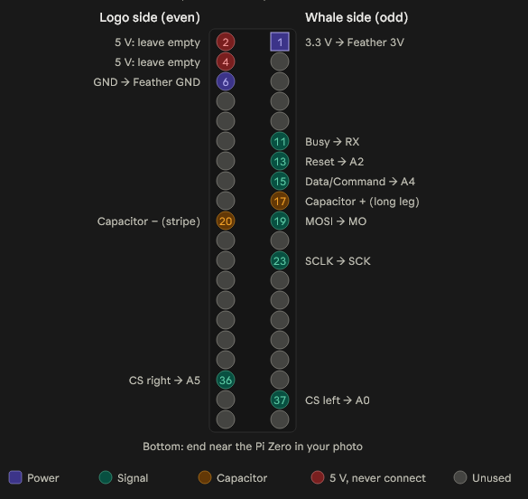
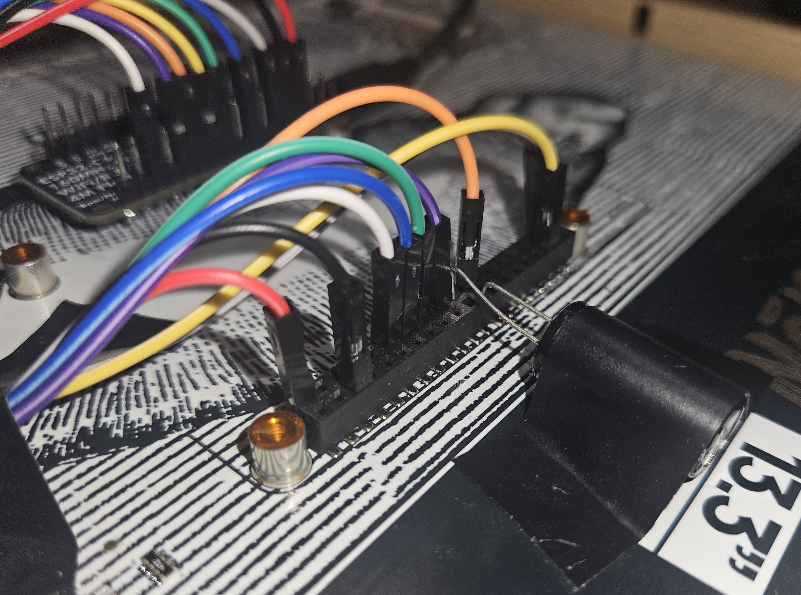
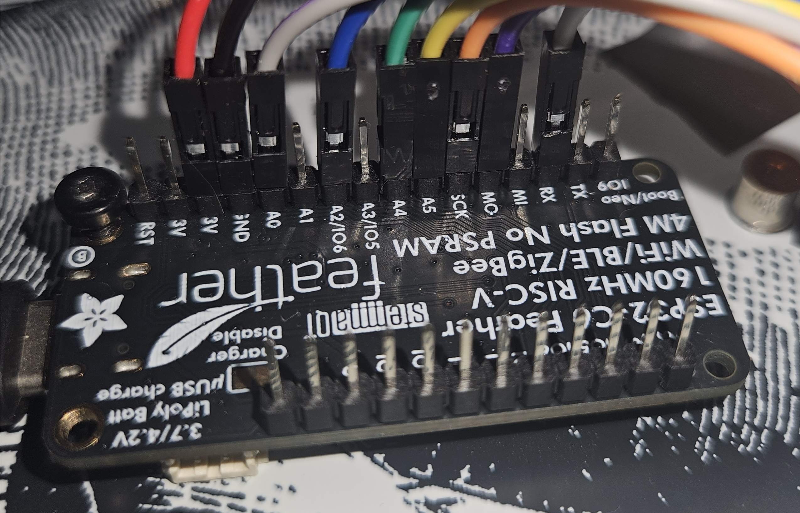

# Feather ESP32-C6 + Inky Impression 13.3", Arduino

Battery-powered firmware for the [Fugleramme](https://github.com/arnegiacomo/fugleramme)
bird frame. Uses [Adafruit Feather ESP32-C6](https://learn.adafruit.com/adafruit-esp32-c6-feather/overview), [Pimoroni Inky Impression
13.3"](https://shop.pimoroni.com/en-eu/products/inky-impression?variant=55186435277179) e-ink panel and shows the birds your Fugleramme server has heard.
With optional Home Assistant reporting for battery and refresh tracking.

The board sleeps most of the time and only wakes up to refresh the frame, skips refresh during a configurable night schedule. Only redraws if the image has changed.

During dev I had a battery puncture... I'll add at some point a model to enclose the battery but anything will do. Just make sure it can't get punctured :)

## How it works

Each wake:

1. Joins WiFi and syncs the clock.
2. Asks for `/frame.e6` with `If-None-Match`. A `304` means nothing changed.
3. Otherwise reads only the 20-byte header. If its CRC matches the page already on
   the glass, nothing changed either. This covers a reverse proxy that strips
   the ETag.
4. Only for a new page: initialises the panel, downloads the page while checking
   its CRC-32, and refreshes only if the CRC matches.
5. Reports to Home Assistant over MQTT, then deep-sleeps.

An unchanged page costs a few seconds of WiFi and no refresh. Checks are skipped
overnight. If the server, proxy or WiFi is down, the last birds stay on the panel
and the frame retries. After a long run of failures it shows an error screen with
the reason instead.

## Hardware

| Part | Notes |
|---|---|
| [Adafruit Feather ESP32-C6](https://learn.adafruit.com/adafruit-esp32-c6-feather) | Built-in LiPo charger and MAX17048 fuel gauge |
| [Pimoroni Inky Impression 13.3"](https://shop.pimoroni.com/en-eu/products/inky-impression?variant=55186435277179/) (EL133UF1, Spectra 6) | 1600×1200, 6 colours |
| 3.7 V single-cell LiPo, JST-PH 2.0 | 2000-5000 mAh, with protection circuit. **Check the polarity** against the Feather's `+`/`−` before plugging it in: not every vendor wires the plug the same way |
| Low-ESR electrolytic capacitor, 1000-1500 µF, ≥ 6.3 V | **Required.** Without it the panel's boost converters pull the 3.3 V rail down at the start of a refresh and the ESP32 browns out |


### Wiring

The Inky is a Raspberry Pi HAT, so its pins are numbered like the Pi's 40-pin
header. Pin 1 is the corner one on the back of the whale and 2 is the one on the logo side, odd pins are on one row, even pins on the other.

| Signal | Feather pin | Inky header pin |
|---|---|---|
| 3.3 V | `3V` | 1 |
| GND | `GND` | 6 |
| SCLK | `SCK` | 23 |
| MOSI | `MO` | 19 |
| CS, left half (CS_M) | `A0` | 37 |
| CS, right half (CS_S) | `A5` | 36 |
| Data/Command | `A4` | 15 |
| Reset | `A2` | 13 |
| Busy | `RX` | 11 |
| Capacitor `+` (long leg) | | 17 (3.3 V) |
| Capacitor `−` (striped leg) | | 20 (GND) |

My suggestion is that you solder wires instead of using jumper wires since it will be harder to close after. (ask me how i know...)

**Never connect the Inky's 5 V pins (2 and 4).** Everything runs from the
Feather's 3.3 V regulator.



Example inky wiring


Example ada wiring


Battery is not plugged-in as I had a small puncture and decided to replace it.

## Server setup

In the Fugleramme admin page, under **Frame**:

- **External e-ink panel**: on
- **External panel size**: 13.3
- **Rotation**, **Margin** and **Panel refresh** apply to this panel too. Panel
  refresh also sets how often the frame checks (never more often than every
  `MIN_CHECK_MINUTES`).

## Building and flashing

1. Install [arduino-cli](https://arduino.github.io/arduino-cli/latest/installation/).
2. Copy `src/secrets_template.h` to `src/secrets.h` and fill in your WiFi, the
   full `/frame.e6` address, and optionally your MQTT broker.
3. Adjust `src/config.h` if you like (see below).
4. From this folder:

   ```sh
   arduino-cli compile
   arduino-cli upload --port <your port>   # e.g. COM4 or /dev/ttyACM0
   ```

   `sketch.yaml` pins the ESP32 core and library versions and installs them on the
   first compile. Change its `port:` line to match your machine.

The board is usually in deep sleep, and then its USB port is gone. Before
uploading, close anything holding the port (Arduino IDE's Serial Monitor) and put
the board in bootloader mode: **hold BOOT, tap RESET, release BOOT**. Press RESET
after the upload to start the new firmware.

The log is on the USB serial port at 115200 baud. Press RESET to watch a full wake.

## Updating

Pull the latest version of this repo, keep your `src/secrets.h` (it is
git-ignored), then compile and upload again as above, with the board in
bootloader mode.

## Tested on

- Adafruit Feather ESP32-C6 with a Pimoroni Inky Impression 13.3" (EL133UF1)
  and a 1000-1500 µF capacitor across the Inky's 3.3 V and GND, as wired above.
- ESP32 Arduino core 3.3.11, built and flashed with `arduino-cli` using the
  pinned `sketch.yaml`.
- Running on battery against a Fugleramme server with **External e-ink panel**
  on and size 13.3, reporting battery and refresh status to Home Assistant
  over MQTT.

## Configuration

`src/config.h`:

| Setting | Default | What it does |
|---|---|---|
| `TIME_ZONE` | Central Europe | POSIX TZ rule, for night mode |
| `MIN_CHECK_MINUTES` | 15 | Shortest interval between checks |
| `RETRY_MINUTES` | 15 | Wait after a failure |
| `ERROR_SCREEN_AFTER_FAILURES` | 12 | Failures in a row before the error screen replaces the birds; 0 = never |
| `NIGHT_START_HOUR` / `NIGHT_END_HOUR` | 23 / 6 | No checks in between; set equal to disable |
| `BATTERY_LOW_PERCENT` | 10 | Below this, show "please charge" and stop until reset |
| `DEEP_SLEEP` | true | false stays awake between wakes, for debugging |


## Home Assistant

Set `MQTT_HOST`, `MQTT_USER` and `MQTT_PASSWORD` in `src/secrets.h` (the Mosquitto
add-on accepts any Home Assistant user). The frame then appears through MQTT
discovery as **Fugleramme frame**, with:

- Battery %, battery voltage
- Status (New birds / Unchanged / Failed / Battery low) and last error
- Last refresh, last check, next check
- Last reset reason, WiFi network, signal, IP, failures in a row
- A **Redraw on next wake** button

Leave `MQTT_HOST` empty to turn reporting off. A broker that is down never stops
the birds.

## Troubleshooting

| Log message | Meaning |
|---|---|
| `Last reset: BROWNOUT` | The 3.3 V rail collapsed during a refresh. Check the capacitor and the power wires |
| `BUSY never asserted` | The panel ignored the refresh. Power-cycle fully, then check the Busy, D/C and CS wires |
| `HTTP 404: turn on "External e-ink panel"` | fugleramme admin setting is off |
| `Page is 800x480 ...` | External panel size is not set to 13.3 |
| `HTTP 301 ... redirects to https://...` | Put that address in `FRAME_URL` |
| `HTTP 502/504` | The proxy is up but cannot reach Fugleramme |
| `Download corrupted: CRC ...` | Damaged download; it retries and never draws a bad page |
| `MQTT: cannot connect ... (state 4/5)` | Wrong MQTT user or password (`-2`: wrong host or port) |
| Upload: `Could not open port` | The board is asleep (use BOOT + RESET) or another program holds the port |

The ESP32-C6 only sees 2.4 GHz WiFi. Some routers' WPA3 transition mode, 802.11r
fast roaming or 6 GHz/MLO setups keep it from joining; a plain WPA2 2.4 GHz network
is the safe choice.

## Credits and licences

- The panel driver (`libs/el133`), battery gauge, WiFi, clock and error-screen
  code come from [FutureSharks/e-paper-art-display](https://github.com/FutureSharks/e-paper-art-display),
  MIT licensed. Its driver is written from
  Pimoroni's [inky](https://github.com/pimoroni/inky) `inky_el133uf1.py`.
- The Roboto font in `libs/roboto` is pre-rendered from Google's Roboto,
  Apache License 2.0, via [FutureSharks/inky-ical](https://github.com/FutureSharks/inky-ical).
- The `/frame.e6` format, and the birds, are from
  [arnegiacomo/fugleramme](https://github.com/arnegiacomo/fugleramme).