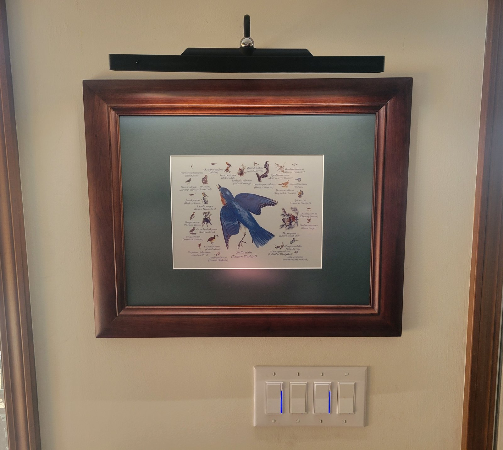

# XIAO EE02 and EE04, Arduino

An Arduino program for the [XIAO EE02](https://www.seeedstudio.com/XIAO-ePaper-Display-Board-ESP32-S3-EE02-p-6639.html) and [EE04](https://www.seeedstudio.com/XIAO-ePaper-Display-Board-EE04-p-6560.html), which run from a battery and can hang anywhere in Wi-Fi range. It wakes for the interval the page's header carries in its **Panel refresh** setting. So a 10 minute setting has it fetch every 10 minutes, and it never fetches more often than its own 5 minute floor, even when **Panel refresh** is off. It downloads the page only if it has changed, and redraws the panel only once the download checks out.

Contributed by [Brent Gerig](https://github.com/brgerig), based on the MicroPython client by [Lorenz Schmid](https://github.com/lorenzschmid) and [Grégoire Seux](https://github.com/kamaradclimber).

## Supported Hardware

- [XIAO EE02](https://www.seeedstudio.com/XIAO-ePaper-Display-Board-ESP32-S3-EE02-p-6639.html) + [Waveshare 13.3" Spectra 6 panel](https://www.waveshare.com/13.3inch-e-paper-hat-plus-e.htm?sku=29353)
- [XIAO EE04](https://www.seeedstudio.com/XIAO-ePaper-Display-Board-EE04-p-6560.html) + [Seeed Studio 7.3" Spectra 6 panel](https://www.seeedstudio.com/7-3inch-Six-Color-eInk-ePaper-Display-with-800x480-Pixels-p-6567.html)

## Install and configure

On Fugleramme's admin page, enable **External e-ink panel** under **Frame** and set **External panel size** to 13.3" or 7.3". Then:

1. Connect your board to your computer. Put your board into bootloader mode: hold down the boot button(1), press reset(2), wait 1 second, and release boot.
2. Visit the [web-based Fugleramme flasher](https://fugleramme.github.io/clients/) in Chrome\*, select your board, click "Connect", and choose your serial port.
3. After flashing, the frame will reboot and start a configuration web portal. Follow the on-display instructions to complete setup.

**\*Important:** The web flasher only supports Chromium-based browsers like Chrome, Edge, and Opera

## Update

Option 1: Download the latest xiao-arduino.ino.bin for [EE02](https://fugleramme.github.io/clients/BOARD_EE02/xiao-arduino.ino.bin) or [EE04](https://fugleramme.github.io/clients/BOARD_EE04/xiao-arduino.ino.bin). Press and hold the KEY2 button on your display board for 5 seconds. The frame will wake up and start a configuration portal, displaying the URL and QR code on the screen. Once on the portal, click "OTA Update" and update using your downloaded .bin file.

Option 2: Flash the newest firmware directly to the board using the [web-based Fugleramme flasher](https://fugleramme.github.io/clients/). **This will erase your wifi and host settings.**

## Operation

| Button | What it does |
| --- | --- |
| RESET | Restart board/force frame redraw |
| A/KEY3 | Next display mode |
| B/KEY2 | Show species names on/off |
| B/KEY2, held for 5 seconds | Start the configuration portal (see Update above) |
| C/KEY1 | Rotate the display 90° clockwise |
| C/KEY1, held for 10 seconds | Reset all settings and launch initial configuration (see Install and configure above) |

These settings are saved on the Fugleramme host and will override any settings set in the admin panel. Give the panel up to a minute to catch up - it redraws slowly.

Note: If an admin password is set on the Fugleramme host, be sure to update the frame's settings with the same password (see Update above).

## Contributing

This client is designed to support multiple boards and displays. To contribute, update driver.h with the correct output from the [Seeed configuration generator](https://seeed-studio.github.io/Seeed_GFX/).

## Tested on

A 13.3" Spectra 6 panel with a XIAO EE02.

A 7.3" Spectra 6 panel with a XIAO EE04

